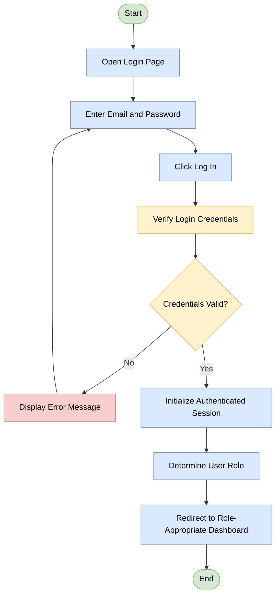
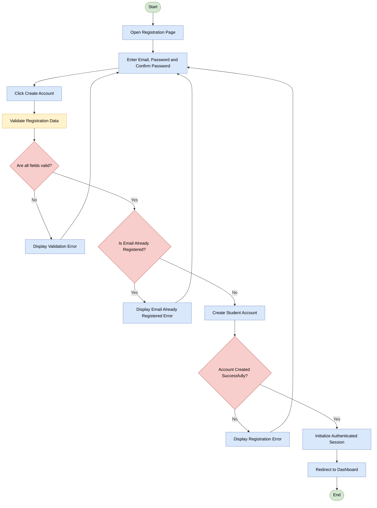
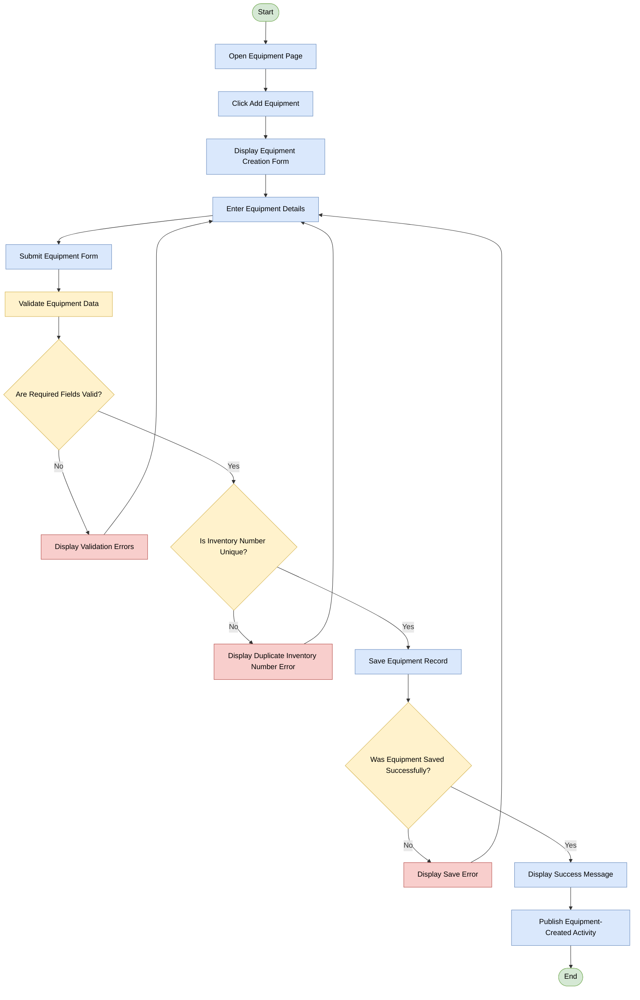
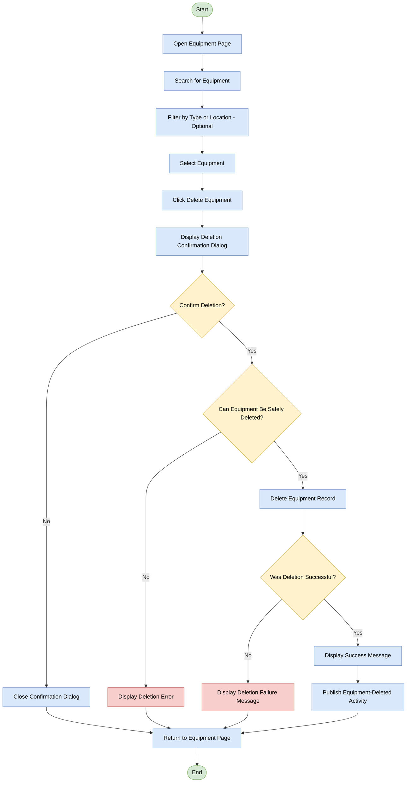
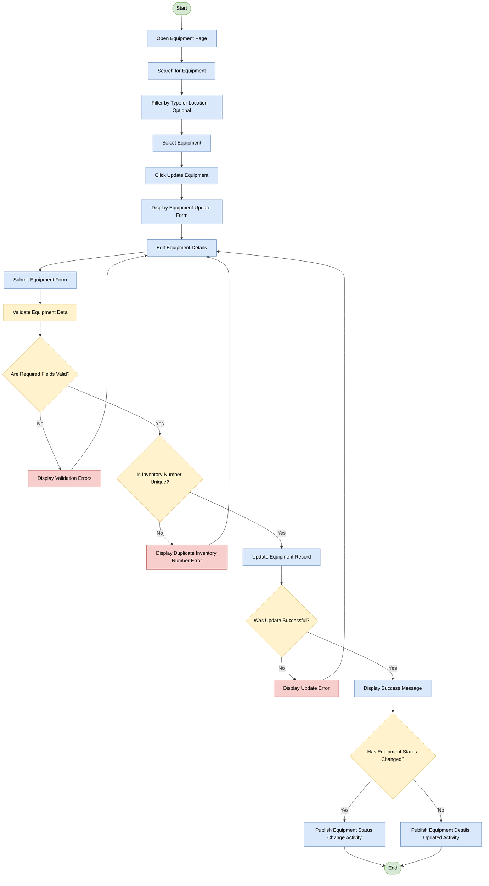
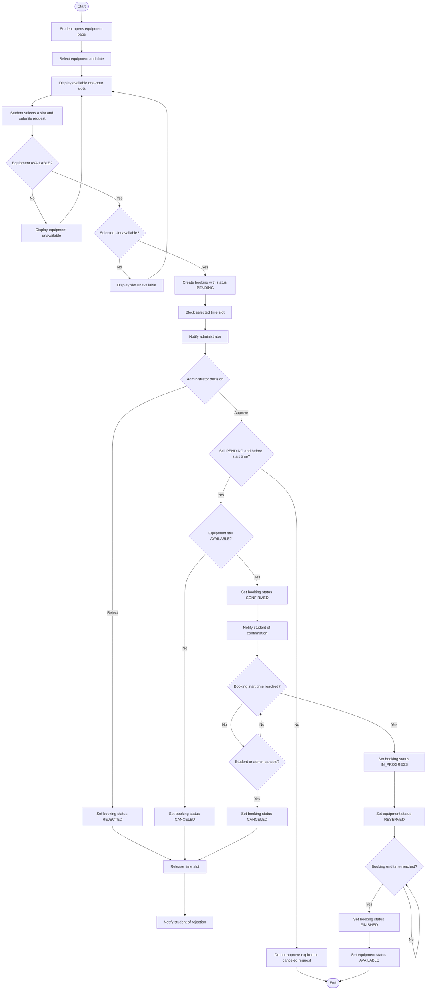
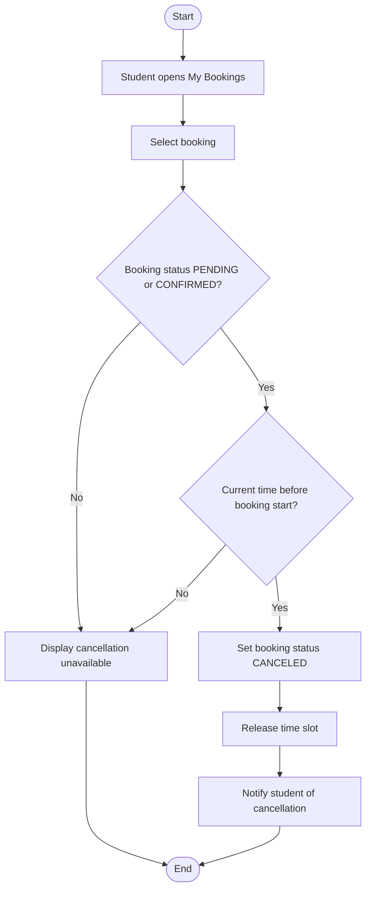
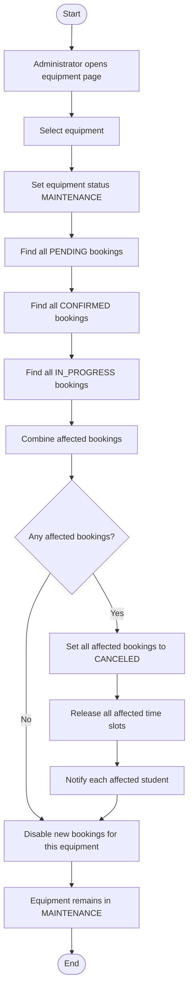
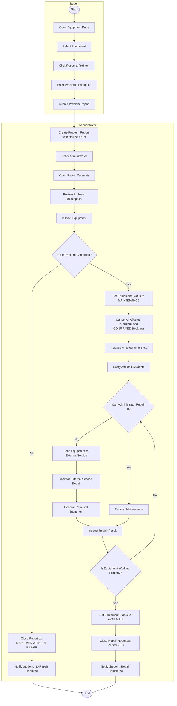

# Laboratory Equipment Management System (LEMS)

## System Overview

**Lab Equipment Management System (LEMS)** is a web-based information system for managing laboratory equipment and reporting equipment malfunctions.

The system allows students to view laboratory equipment, submit booking requests, track their bookings, and report equipment problems. Administrators can manage equipment, process booking requests, and handle reported malfunctions.

## Database Schema

### User

Stores user accounts and authentication information.

| Column | Data Type | Constraints |
|---|---|---|
| `id` | INTEGER | Primary Key |
| `name` | VARCHAR(10) | |
| `surname` | VARCHAR(15) | |
| `email` | VARCHAR(20) | |
| `password_hash` | VARCHAR(255) | |
| `role` | ENUM | `STUDENT`, `ADMIN` |
| `created_at` | TIMESTAMP | |

### Equipment

Stores information about laboratory equipment.

| Column | Data Type | Constraints |
|---|---|---|
| `id` | INTEGER | Primary Key |
| `inventory_number` | VARCHAR(10) | |
| `title` | VARCHAR(25) | |
| `description` | VARCHAR(250) | |
| `location` | VARCHAR(10) | |
| `status` | ENUM | `AVAILABLE`, `RESERVED`, `MAINTENANCE` |
| `created_at` | TIMESTAMP | |

### Booking

Stores equipment booking requests and their current statuses.

| Column | Data Type | Constraints |
|---|---|---|
| `id` | INTEGER | Primary Key |
| `user_id` | INTEGER | Foreign Key → `User.id` |
| `equipment_id` | INTEGER | Foreign Key → `Equipment.id` |
| `description` | TEXT | |
| `start_time` | DATETIME | |
| `end_time` | DATETIME | |
| `status` | ENUM | `PENDING`, `CONFIRMED`, `REJECTED`, `CANCELED`, `IN_PROGRESS`, `FINISHED` |
| `created_at` | TIMESTAMP | |

### RepairRequest

Stores reports submitted by users about equipment malfunctions.

| Column | Data Type | Constraints |
|---|---|---|
| `id` | INTEGER | Primary Key |
| `created_by` | INTEGER | Foreign Key → `User.id` |
| `equipment_id` | INTEGER | Foreign Key → `Equipment.id` |
| `title` | VARCHAR(50) | |
| `description` | VARCHAR(500) | |
| `status` | BOOL |`OPEN`/`CLOSED`|

## Roles
- **Student** — registers independently, books equipment, cancels their own bookings, and reports problems.
- **Administrator** — manages equipment (creation, modification, deletion, and placing equipment under maintenance), approves or rejects bookings, and processes repair requests.

## Equipment Statuses
| Status | Meaning |
|---|---|
| `AVAILABLE` | Available for booking |
| `RESERVED` | Currently occupied by an active booking (`IN_PROGRESS`) |
| `MAINTENANCE` | Under maintenance or repair; new bookings are prohibited |

## Booking Statuses
| Status | Meaning |
|---|---|
| `PENDING` | Created by a student and awaiting an administrator's decision |
| `CONFIRMED` | Approved by the administrator |
| `REJECTED` | Rejected by the administrator |
| `CANCELED` | Cancelled (by the student, administrator, or system) |
| `IN_PROGRESS` | The start time has been reached, and the equipment is in use |
| `FINISHED` | The end time has been reached, and the booking is complete |

## Problem Report Statuses
| Status | Meaning |
|---|---|
| `OPEN` | The report has been created and is awaiting review |
| `CLOSED` | The problem has been resolved, and the report is closed |

## Booking Lifecycle (Summary)
`PENDING` → `CONFIRMED` → `IN_PROGRESS` → `FINISHED`

`PENDING` → `REJECTED`

`PENDING` / `CONFIRMED` / `IN_PROGRESS` → `CANCELED`

## 4. Business Processes

### 1. Log In

### 2. Registration Activity for Student

### 3. Creating a New Equipment by Admin

### 4. Deleting the Equipment by Admin

### 5. Updating the Equipment by Admin

### 6. Booking the Equipment by Student

### 7. Cancelation Booking

### 8. Changes Equipment Status to "MAINTENANCE"

### 9. Report Equipment Problem

## 5. Business Rules

### 1. System Login (Log In)

**Participants:** any registered user.

**Main scenario:**
1. The user opens the login page.
2. Enters email and password and clicks "Log In".
3. The system verifies the credentials.
4. The system creates an authenticated session.
5. The system determines the user's role.
6. The system redirects the user to the dashboard that corresponds to the role.

**Alternative scenario:** the credentials are invalid — an error message is displayed, and the user returns to entering email and password.

**Business rules:**
- **BR-AUTH-01.** Login is performed using an "email + password" pair.
- **BR-AUTH-02.** A session is created only after the credentials are successfully verified.
- **BR-AUTH-03.** The dashboard the user lands on is determined by their role (student or administrator).
- **BR-AUTH-04.** If the credentials are invalid, login is not performed, and the user can retry without a limit on the number of attempts.

---

### 2. Student Registration (Registration Activity for Student)

**Participants:** new user (student).

**Main scenario:**
1. The user opens the registration page.
2. Enters email, password, and password confirmation, and clicks "Create Account".
3. The system validates the data. The email must match this pattern: `name.surname@student.tuke.sk`
5. The system checks that the email is not yet registered.
6. The system creates a student account.
7. The system creates an authenticated session and redirects the user to the dashboard.

**Alternative scenarios (in all cases the user returns to entering data):**
- Fields are filled in incorrectly — a validation error is displayed.
- The email is already registered — the "Email Already Registered" error is displayed.
- The account could not be created — a registration error is displayed.

**Business rules:**
- **BR-REG-01.** Self-registration creates an account only with the "student" role. Administrators are not created through this form.
- **BR-REG-02.** Email, password, and password confirmation are required for registration.
- **BR-REG-03.** The email must be unique in the system.
- **BR-REG-04.** All fields must pass validation before the account is created (in particular, the password and its confirmation must match).
- **BR-REG-05.** After successful registration, the user is logged in automatically (a repeated login is not required).

---

### 3. Creating Equipment by an Administrator

**Participants:** administrator.

**Main scenario:**
1. The administrator opens the equipment page and clicks "Add Equipment".
2. The system displays the creation form.
3. The administrator enters the data and submits the form.
4. The system checks the required fields and the uniqueness of the inventory number.
5. The system saves the equipment record.
6. The system displays a success message and publishes the "Equipment Created" event.

**Alternative scenarios (return to editing the form):**
- Required fields are invalid — validation errors.
- The inventory number already exists — duplicate error.
- Save error — a save error message.

**Business rules:**
- **BR-EQ-C-01.** Equipment is created only by an administrator.
- **BR-EQ-C-02.** The required form fields must be filled in and valid.
- **BR-EQ-C-03.** The inventory number is unique across the entire system.
- **BR-EQ-C-04.** Every successful creation of equipment generates the "Equipment Created" activity event.
- **BR-EQ-C-05.** In case of any error, the form data is preserved for correction, and no record is created.

---

### 4. Deleting Equipment by an Administrator

**Participants:** administrator.

**Main scenario:**
1. The administrator opens the equipment page and searches for the needed item (filtering by type or location if necessary).
2. Selects the equipment and clicks "Delete Equipment".
3. The system displays a confirmation dialog.
4. The administrator confirms the deletion.
5. The system displays a second window with a repeated question asking whether this equipment really needs to be deleted.
6. The administrator confirms again.
7. The system deletes the record, displays a success message, and publishes the "Equipment Deleted" event.
8. The administrator returns to the equipment page.

**Alternative scenarios:**
- The administrator canceled the deletion in the first window — the dialog closes, and the administrator returns to the equipment page.
- The administrator declined the deletion in the second window — the record remains, and the administrator returns to the equipment page.
- The deletion failed technically — a failure message is displayed.

**Business rules:**
- **BR-EQ-D-01.** Deletion requires explicit confirmation by the administrator.
- **BR-EQ-D-02.** The record is deleted only after both confirmations. The system performs no other checks (for example, regarding bookings).
- **BR-EQ-D-03.** Upon successful deletion, the "Equipment Deleted" event is published.
- **BR-EQ-D-04.** After any outcome (cancellation, error, success), the administrator returns to the equipment page.

---

### 5. Updating Equipment by an Administrator

**Participants:** administrator.

**Main scenario:**
1. The administrator opens the equipment page, searches for and selects an item.
2. Clicks "Update Equipment", and the system displays the edit form.
3. The administrator changes the data and submits the form.
4. The system checks the required fields and the uniqueness of the inventory number.
5. The system updates the record and displays a success message.
6. The system publishes the event:
   - "Equipment Status Change" if the equipment status has changed;
   - "Equipment Details Updated" if only other data has changed.

**Alternative scenarios (return to editing):** validation errors, duplicate inventory number, update error.

**Business rules:**
- **BR-EQ-U-01.** The validation rules for updating are the same as for creation: required fields and uniqueness of the inventory number.
- **BR-EQ-U-02.** The type of event published depends on whether the equipment status has changed.
- **BR-EQ-U-03.** The event is published only after the changes are successfully saved.

---

### 6. Booking Equipment by a Student

**Participants:** student, administrator, system.

**Main scenario:**
1. The student opens the equipment page and selects the equipment and a date.
2. The system displays the available hourly slots.
3. The student selects a slot and submits the request.
4. The system checks that the equipment is not in the `MAINTENANCE` status (the `RESERVED` status does not prevent booking) and that the selected slot is free.
5. The system creates a booking with the `PENDING` status, blocks the slot, and notifies the administrator.
6. The administrator makes a decision:
   - **Reject:** status `REJECTED`, the slot is released, the student receives a rejection notification.
   - **Approve:** the system checks that the booking is still `PENDING` and the start time has not yet arrived, and that the equipment has not moved to `MAINTENANCE`. If so, the booking receives the `CONFIRMED` status, and the student receives a notification.
7. When the start time arrives, the booking moves to `IN_PROGRESS`, and the equipment receives the `RESERVED` status.
8. When the end time arrives, the booking moves to `FINISHED`, and the equipment becomes `AVAILABLE` again (if it was not moved to `MAINTENANCE`).

**Alternative scenarios:**
- The equipment is in the `MAINTENANCE` status — the message "equipment unavailable" is displayed, and booking is impossible. Equipment in the `RESERVED` status can be selected; the student chooses a free slot for another time.
- The slot is taken — the message "slot unavailable" is displayed, and the student returns to slot selection.
- The booking is no longer `PENDING` or the start time has passed — approval is not performed (an expired or canceled request is not confirmed).
- The equipment moved to `MAINTENANCE` by the time of approval — the booking receives the `CANCELED` status, and the slot is released.
- The administrator did not make a decision in time — the booking is automatically moved to `CANCELED`, the slot is released, and the student receives a notification.
- Between confirmation and the start, the student or the administrator cancels the booking — status `CANCELED`, the slot is released.

**Business rules:**
- **BR-BK-01.** Booking is done in the form of hourly slots on the selected date.
- **BR-BK-02.** Equipment with the `AVAILABLE` or `RESERVED` status can be booked. `RESERVED` only means that the equipment is currently being used by someone, so other students can book it for another time. Equipment in `MAINTENANCE` cannot be booked.
- **BR-BK-03.** An already occupied slot cannot be booked.
- **BR-BK-04.** A new booking is always created with the `PENDING` status and requires an administrator's decision (there is no auto-confirmation).
- **BR-BK-05.** The slot is blocked immediately when the booking is created (in the `PENDING` status), not after confirmation. This prevents double booking; so that unconfirmed requests do not occupy slots indefinitely, the decision waiting period is limited (BR-BK-15).
- **BR-BK-06.** The administrator is notified about each new booking request.
- **BR-BK-07.** The student is notified about the rejection and the confirmation of the booking.
- **BR-BK-08.** The slot is released when the booking moves to `REJECTED` or `CANCELED`.
- **BR-BK-09.** Only a booking in the `PENDING` status whose start time has not yet arrived can be approved.
- **BR-BK-10.** Upon approval, the system re-checks that the equipment has not moved to `MAINTENANCE`; otherwise the booking is canceled.
- **BR-BK-11.** The transition `CONFIRMED` → `IN_PROGRESS` happens automatically when the start time arrives.
- **BR-BK-12.** At `IN_PROGRESS`, the equipment receives the `RESERVED` status.
- **BR-BK-13.** The transition `IN_PROGRESS` → `FINISHED` happens automatically when the end time arrives.
- **BR-BK-14.** At `FINISHED`, the equipment returns to the `AVAILABLE` status, if it was not moved to `MAINTENANCE` during the booking.
- **BR-BK-15.** The waiting period for the administrator's decision is limited: if the booking remains in `PENDING`, it is automatically moved to `CANCELED` when the earlier of the following events occurs — 24 hours have passed since creation, or the booking start time has arrived. The slot is released, and the student receives a notification.

---

### 7. Canceling a Booking

**Participants:** student.

**Main scenario:**
1. The student opens "My Bookings" and selects a booking.
2. The system checks that the booking status is `PENDING` or `CONFIRMED` and that the current time is earlier than the start time.
3. The system moves the booking to `CANCELED`, releases the slot, and notifies the student about the cancellation.

**Alternative scenario:** the conditions are not met — the message "cancellation unavailable" is displayed, and the process ends without changes.

**Business rules:**
- **BR-CN-01.** A student can cancel only a booking in the `PENDING` or `CONFIRMED` status.
- **BR-CN-02.** Cancellation is possible only before the booking start time.
- **BR-CN-03.** A booking in the `IN_PROGRESS`, `FINISHED`, `REJECTED`, `CANCELED` statuses cannot be canceled.
- **BR-CN-04.** Upon cancellation, the slot is released, and the student receives a notification.

---

### 8. Moving Equipment to the MAINTENANCE Status by an Administrator

**Participants:** administrator.

**Main scenario:**
1. The administrator opens the equipment page and selects an item.
2. Sets the `MAINTENANCE` status.
3. The system finds all bookings of this equipment in the `PENDING` and `CONFIRMED` statuses for any future dates. Bookings in the `IN_PROGRESS` status are not affected.
4. If there are such bookings, the system moves them to `CANCELED`, releases the slots, and notifies each affected student.
5. The system disables the ability to make new bookings for this equipment.
6. The equipment remains in the `MAINTENANCE` status.

**Business rules:**
- **BR-MT-01.** The `MAINTENANCE` status is set by the administrator.
- **BR-MT-02.** Moving to `MAINTENANCE` automatically cancels all bookings in the `PENDING` and `CONFIRMED` statuses, including those for future dates (not only the nearest ones).
- **BR-MT-03.** The slots of all canceled bookings are released.
- **BR-MT-04.** Each affected student receives a cancellation notification.
- **BR-MT-05.** While the equipment is in `MAINTENANCE`, new bookings cannot be created (follows from BR-BK-02).
- **BR-MT-06.** If there are no affected bookings, new bookings are still disabled.
- **BR-MT-07.** Canceled bookings are not restored, even if the equipment has returned to `AVAILABLE`. The student creates a new booking from scratch.
- **BR-MT-08.** A booking in the `IN_PROGRESS` status is not canceled and finishes in the normal way. After its `FINISHED`, the equipment remains in `MAINTENANCE` (see BR-BK-14).

---

### 9. Reporting a Problem with Equipment

**Participants:** student, administrator.

**Main scenario (student):**
1. The student opens the equipment page, selects the equipment, and clicks "Report a Problem".
2. Enters a description of the problem and submits the report.

**Main scenario (administrator):**
1. The system creates a request with the `OPEN` status and notifies the administrator.
2. The administrator opens "Repair Requests", reviews the description, and inspects the equipment.
3. If the problem is confirmed:
   - the equipment is moved to `MAINTENANCE`;
   - all affected `PENDING` and `CONFIRMED` bookings are canceled, the slots are released, and the students are notified;
   - if the administrator can fix it themselves, maintenance is performed; otherwise the equipment is sent to an external service, the administrator waits for the repair and receives the equipment back;
   - the administrator checks the result of the repair;
   - if the equipment works, the status changes to `AVAILABLE`, the request is closed as `CLOSED`, and the student is notified about the completion of the repair.

**Alternative scenarios:**
- The problem is not confirmed — the request is closed as `CLOSED`, and the student receives a notification that no repair is required.
- The equipment does not work after the repair — the process returns to the decision "can the administrator repair it themselves" (repeated repair cycle).

**Business rules:**
- **BR-RP-01.** Any student can report a problem with any equipment; a description of the problem is mandatory.
- **BR-RP-02.** Each request is created with the `OPEN` status, and the administrator is notified.
- **BR-RP-03.** The decision on confirming the problem is made by the administrator after inspecting the equipment.
- **BR-RP-04.** If the problem is not confirmed, the request is closed as `CLOSED`, the equipment status does not change, and the student receives a notification.
- **BR-RP-05.** Confirming the problem moves the equipment to `MAINTENANCE` and cancels the affected bookings (rules BR-MT-02 – BR-MT-08 apply: `PENDING` and `CONFIRMED` bookings are canceled, canceled bookings are not restored).
- **BR-RP-06.** The repair is performed either by the administrator or by an external service.
- **BR-RP-07.** Inspecting the result is mandatory after the repair. Until the equipment works properly, the repair cycle repeats.
- **BR-RP-08.** Only after a successful check does the equipment receive the `AVAILABLE` status, the request is closed as `CLOSED`, and the student is notified.

---

### 10. Cross-Cutting Rules

- **BR-GEN-01.** Booking is unavailable only for equipment in `MAINTENANCE`. Equipment in `AVAILABLE` and `RESERVED` can be booked.
- **BR-GEN-02.** Any transition of a booking from active statuses to `REJECTED` or `CANCELED` releases the slot.
- **BR-GEN-03.** All booking changes that affect the student (confirmation, rejection, cancellation, repair) are accompanied by a notification to the student.
- **BR-GEN-04.** All changes to the equipment catalog (creation, deletion, update) are published as activity events.
- **BR-GEN-05.** Equipment management and decisions on bookings and repairs are available only to the administrator. A student creates bookings, cancels their own bookings, and submits problem reports.
- **BR-GEN-06.** In case of validation or save errors, the system does not change the data and returns the user to input.
- **BR-GEN-06.** The external service is not implemented as a separate entity or functional component of the system. It is represented only in the business scenario to show a possible equipment repair process. Separate buttons, interface elements, and program logic for interacting with the external service are not required.

## 6. User Interface Requirements

1. The top bar is a compact status area located on the right side of the interface, designed to provide quick access to the user profile and notifications. It contains a notification indicator represented by a bell icon with a prominent badge indicating new system messages or updates. Next to it is the current account section, consisting of a circular avatar displaying the user's initials and their full name, ensuring constant visual identification of the authenticated user. Clicking the dropdown arrow next to the name opens a menu displaying the account role and providing a logout option.

2. The sidebar navigation is located on the left side of the screen and serves as the primary navigation component of the LEMS (Laboratory Equipment Management System) web application. At the top, it displays the system logo, featuring a laboratory equipment icon and the system name. The main area contains a vertical list of key sections with icons and labels. For the `STUDENT` role: Dashboard, Equipment, Bookings, and Repair Requests. For the `ADMIN` role: Dashboard, Bookings, and Repair Requests.

3. The interface follows a modern, minimalist desktop web application style (Modern SaaS / Admin Dashboard), emphasizing readability and a clear card-based layout. The visual design combines a soft, light gray-blue background (#F8FAFC) with clean white cards, subtle gray borders, and neatly rounded corners (border radius: 8–12px). Typography uses a clean sans-serif font with a clear hierarchy: high-contrast dark blue headings paired with muted gray secondary text. A saturated blue is used for active navigation elements and filters. Soft pastel badges with corresponding color indicators are used to make statuses such as Pending, Confirmed, Rejected, and Cancelled easy to recognize at a glance.

4. **Dashboard** — The student and administrator dashboards share the same basic layout. They display the number of equipment items with the statuses `AVAILABLE`, `RESERVED`, and `MAINTENANCE`. Administrators additionally have access to repair request statistics showing the number of requests with `OPEN` and `CLOSED` statuses, as well as the total number of registered students and administrators. Both roles have an activity feed that displays important system events in real time.

   - **Equipment becomes available for booking:**

     “Equipment [Equipment Name] (Inventory No.: [Inventory Number]) at [Location] is now available for booking.”

   - **Equipment is reserved:**

     “Equipment [Equipment Name] (Inventory No.: [Inventory Number]) at [Location] is now reserved from [Start Time] to [End Time] on [Date].”

   - **New equipment is added:**

     “New equipment [Equipment Name] (Inventory No.: [Inventory Number]) has been added to the laboratory inventory at [Location].”

   - **Equipment is removed:**

     “Equipment [Equipment Name] (Inventory No.: [Inventory Number]) has been removed from the laboratory inventory at [Location].”

   - **Equipment details are updated:**

     “The following details of equipment [Equipment Name] (Inventory No.: [Inventory Number]) have been updated: [Updated Fields] at [Location].”

   - **Equipment is placed under maintenance:**

     “Equipment [Equipment Name] (Inventory No.: [Inventory Number]) at [Location] has been placed under maintenance and is unavailable for booking. All affected reservations have been cancelled.”

5. **Equipment page:** An equipment catalog with flexible filtering and search functionality.

   The page begins with a prominent Equipment heading and a brief explanatory subtitle, followed by a search bar that allows users to search by equipment name or inventory number. Dropdown filters are provided for categories, statuses, and sorting. Below the search and filter panel, interactive tabs display equipment counts for All Equipment, Available, Reserved, and Maintenance.

   The main content area contains a grid of equipment cards arranged in three columns. Each card includes a thumbnail image, equipment name, inventory number, associated laboratory, and a color-coded status badge (e.g., green for Available, yellow for Reserved, and red for Maintenance). Each card also provides two action buttons: Book and Report Issue.

   At the bottom of the content area, a counter displays the number of currently visible items, accompanied by pagination controls.

   The administrator view includes additional buttons and actions corresponding to the administrator's permissions, such as adding, editing, and removing equipment.

6. **Remaining pages:** Implement all other sections using the same clean, intuitive visual style as the existing pages. Maintain a consistent layout, clear navigation, and straightforward interactions across the application to provide a smooth and user-friendly experience.

## 7. Technical Requirements

1. The main backend service must be implemented in C#, while the AI component must be implemented in Python. 
2. Sessions must be implemented to manage user authentication and maintain user state across requests.

## 7. Issues

1. Identify and resolve any logical inconsistencies in the existing scenarios. Make reasonable corrections independently to ensure the system works reliably and remains consistent with the defined business processes and rules.
