<div align="left">
  
</div>

# Lab Equipment Management System (LEMS)

Lab Equipment Management System (LEMS) is a web-based information system designed to simplify laboratory equipment management and malfunction reporting.

The system allows students to view laboratory equipment, submit booking requests, track their bookings, and report equipment problems. Administrators can manage equipment, process booking requests, and handle reported malfunctions.

## Screenshots

<details>
<summary>Login Page</summary>

<div align="center">

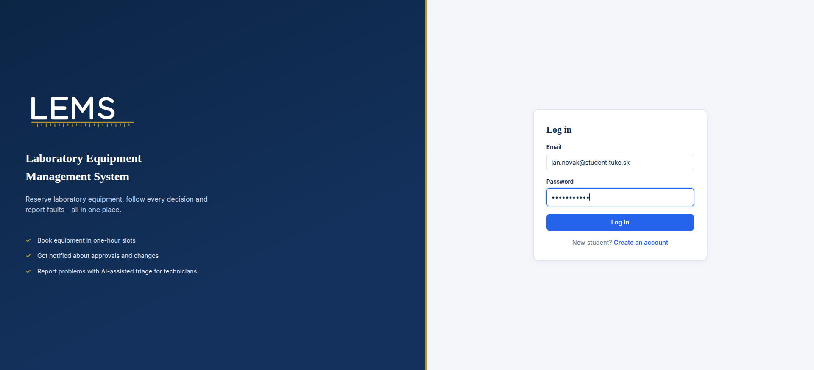

</div>

</details>

<details>
<summary>Student Registration</summary>

<div align="center">

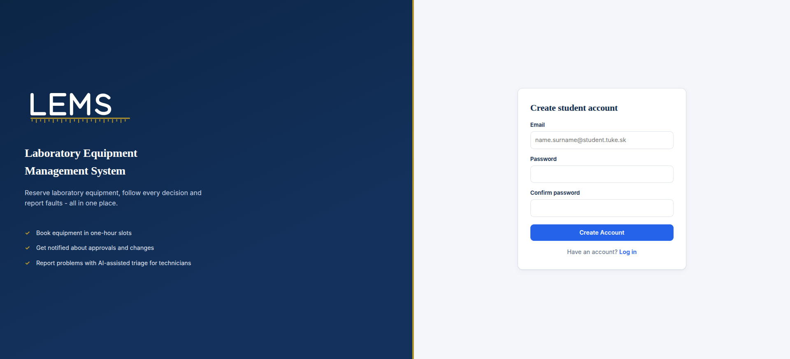

</div>

</details>

<details>
<summary>Dashboard</summary>

<div align="center">

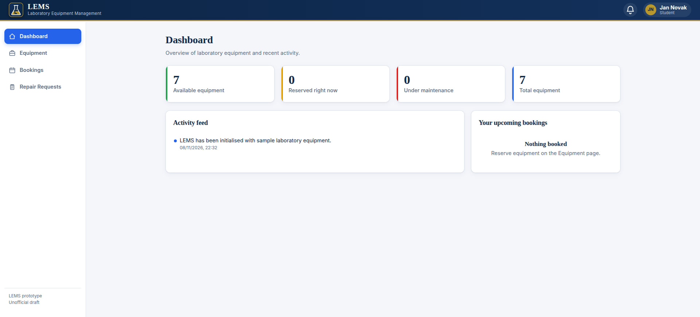

</div>

</details>

<details>
<summary>Equipment — Student View</summary>

<div align="center">

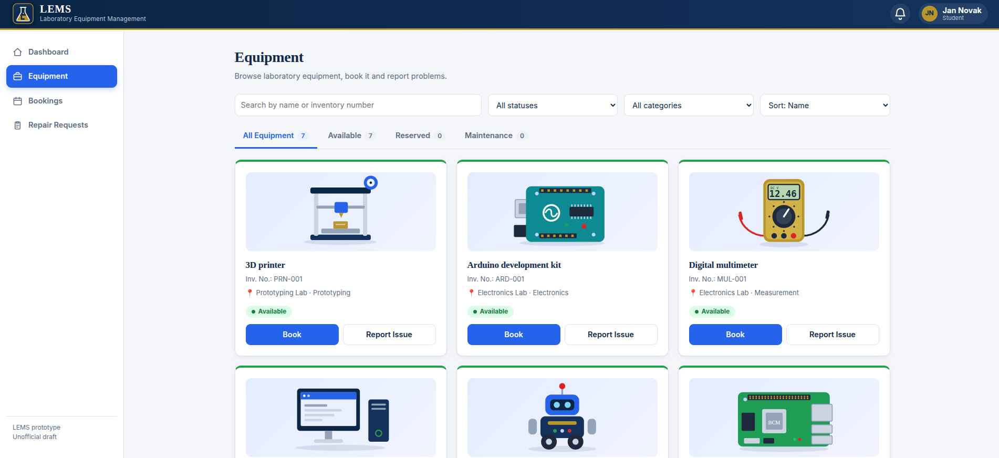

</div>

</details>

<details>
<summary>Equipment Booking</summary>

<div align="center">

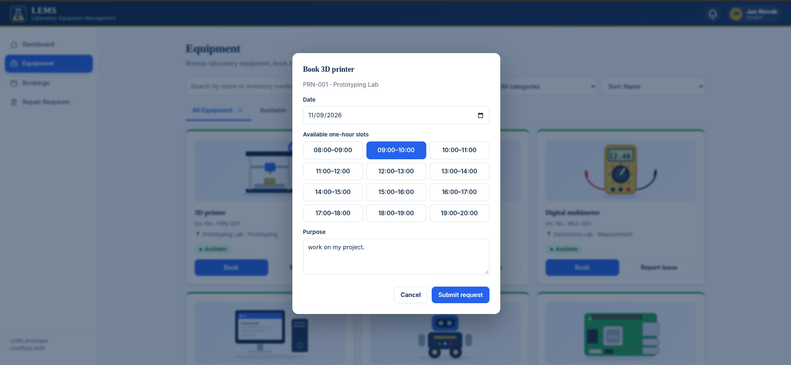

</div>

</details>

<details>
<summary>Student Bookings</summary>

<div align="center">

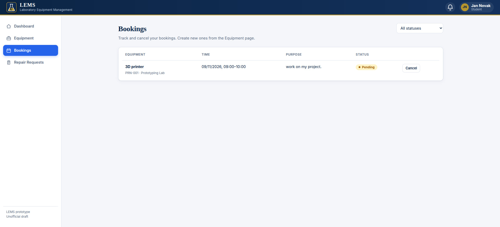

</div>

</details>

<details>
<summary>Report an Issue</summary>

<div align="center">

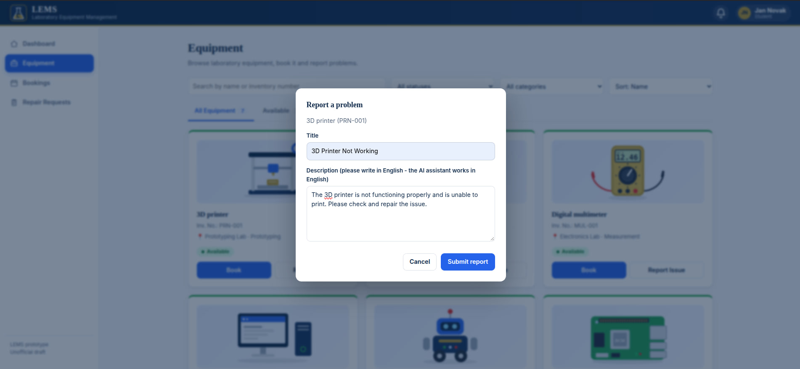

</div>

</details>

<details>
<summary>Student Repair Requests</summary>

<div align="center">

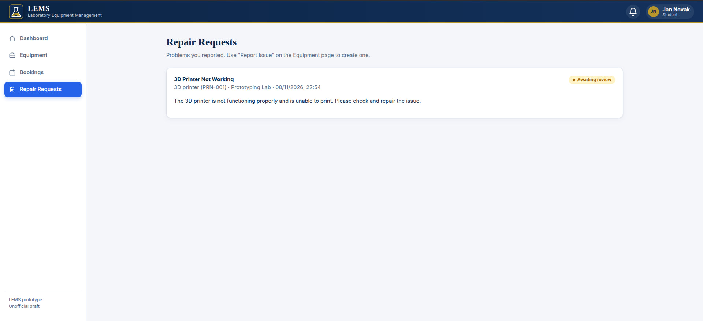

</div>

</details>

<details>
<summary>Equipment Management — Admin</summary>

<div align="center">

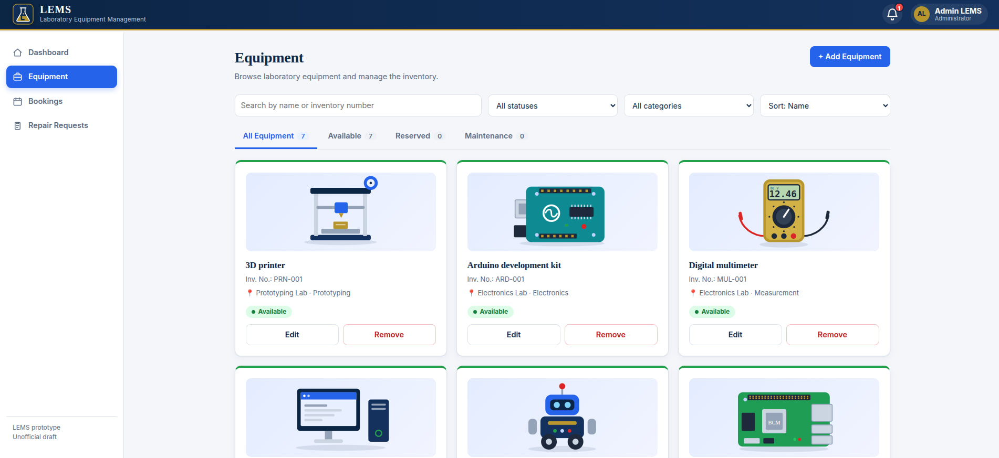

</div>

</details>

<details>
<summary>Update Equipment</summary>

<div align="center">

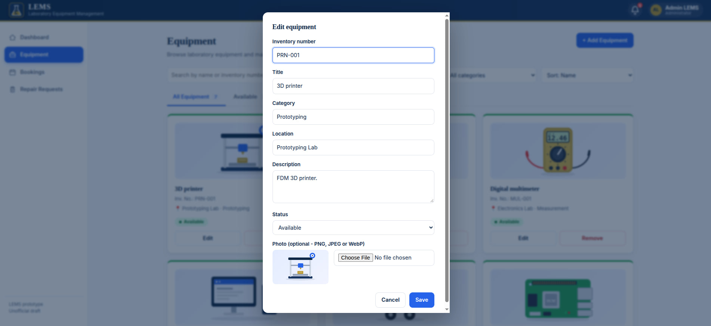

</div>

</details>

<details>
<summary>Repair Requests — Admin</summary>

<div align="center">

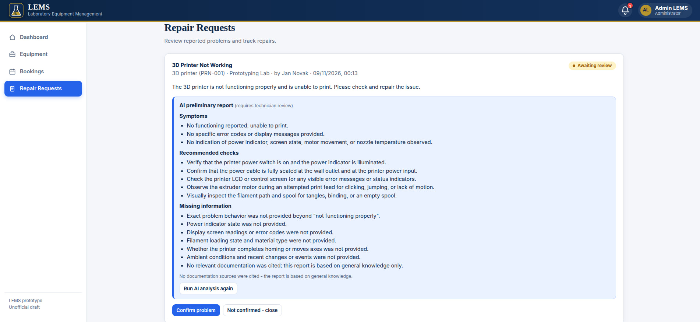

</div>

</details>

## BPMN

This diagram illustrates the LEMS business process ([PNG](docs/assets/bpmn.png), [SVG](docs/assets/bpmn.svg)).

## Project structure

| Folder | What it is | Container |
|---|---|---|
| `frontend/` | Web UI (static HTML/CSS/JS) served by nginx; proxies `/api/*` to the backend | `lems-frontend` (the only service published to the browser, port 5000) |
| `backend/` | ASP.NET Core 8 REST API (auth, equipment, bookings, repairs) | `lems-backend` (internal port 8080) |
| `ai-service/` | Python FastAPI service for AI failure reports | `lems-ai-service` (port 8000) |
| `tests/` | `backend/` (xUnit API tests), `frontend/` (jsdom smoke tests) | - |

The browser talks only to the frontend container. It forwards `/api/*` to the backend on the same origin, so session
cookies and the backend's CSRF check work without CORS.

## Usage

```bash
# Clone the repository
git clone https://github.com/Archi816/AIS_PU-project.git
cd AIS_PU-project

# Build and start all containers (frontend, backend, ai-service)
docker compose up --build -d

# Stop the containers
docker compose down
```

> Make sure to create and configure `backend/.env` and `ai-service/.env` (see the `.env.example` files) before starting the containers.

Local run without cloud accounts (SQLite databases, demo data; the AI service is started separately):

```bash
docker compose -f docker-compose.local.yml up --build
```

Open [http://localhost:5000](http://localhost:5000) and sign in with a demo
account (demo accounts exist only in the Development environment, i.e. the local compose file):

- Admin: `admin@lems.local` / `Admin123!`
- Student: `jan.novak@student.tuke.sk` / `Student123!`

Backend settings for the split: `Security__BehindProxy=true` (set in the compose files) makes the API trust
`X-Forwarded-For` / `X-Forwarded-Proto` from the frontend container. Do not publish the backend port to the internet in this mode.
Frontend setting: `BACKEND_URL` (default `http://backend:8080`) is the address nginx proxies `/api/*` to.

## E-mail notifications (optional)

Students get an e-mail when a booking request is received, confirmed, rejected or canceled (also when the system
cancels it: maintenance, removed equipment, no decision within 24 h). A **confirmed** booking carries an `.ics` calendar
file (Google Calendar, Outlook, Apple) and an "Add to Google Calendar" link; canceling a confirmed booking sends an
`.ics` with `METHOD:CANCEL` and the same UID, so the event disappears from the calendar. Each student can switch e-mails
off in **Profile**. Messages are sent by a background worker (MailKit/SMTP): a failing mail server never breaks a booking.

Set the SMTP server in `backend/.env` (see `.env.example`): `Smtp__Host`, `Smtp__Port`, `Smtp__User`, `Smtp__Password`,
`Smtp__From`, `Smtp__PublicUrl`. With an empty `Smtp__Host` e-mails are simply off.

**Database note:** new columns (`Equipment.specifications/contact_name/contact_email`, `Users.email_notifications`) are added
automatically to an existing database when the backend starts (`Services/SchemaUpgrade.cs`), no data is lost.

## Architecture

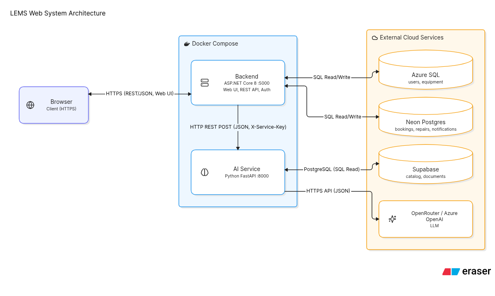

## AI Service

The AI component helps generate a preliminary equipment failure report. It searches for relevant information in the catalog and documentation, then produces a structured response containing symptoms, possible causes, recommended inspection steps, and missing information.

Search is performed using semantic similarity with a local embedding model. Report generation can be configured to use either OpenRouter or Azure OpenAI. The response is returned in JSON format, including references to the source documentation whenever available.

## Authors

- **Dmytro Varich** ([Github](https://github.com/dmytro-varich), [Outlook](mailto:dmytro.varich@student.tuke.sk))
- **Daniil Sputai** ([Github](https://github.com/Sputaiok1925), [Outlook](mailto:daniil.sputai@student.tuke.sk))
- **Artem Polianetskyi** ([Github](https://github.com/Archi816), [Outlook](mailto:artem.polianetskyi@student.tuke.sk))
- **Myroslav Yatsenko** ([Github](https://github.com/Mirikkirim-dev), [Outlook](mailto:myroslav.yatsenko@student.tuke.sk))
